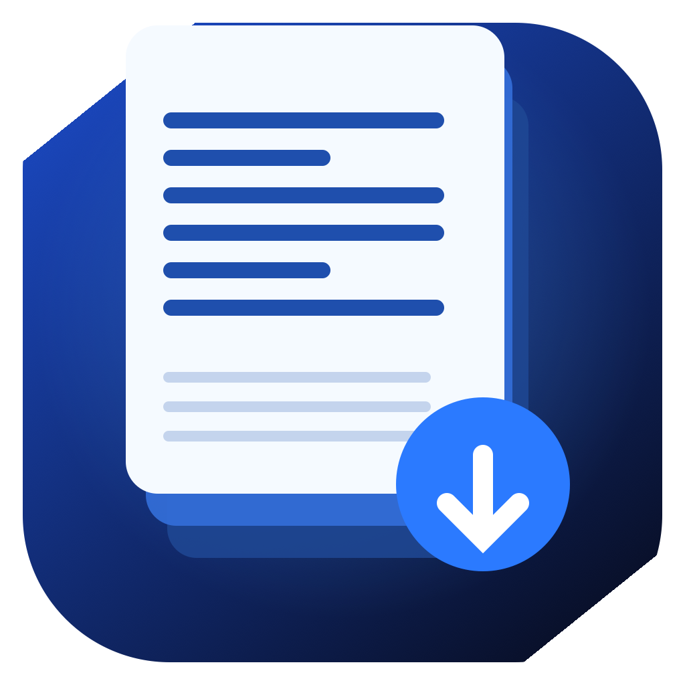

# Longshot

常驻 macOS 菜单栏的滚动长截图工具。单击菜单栏图标 → 拖动框选区域 → 在区域内滚动鼠标/触控板，新出现的内容会自动拼接成一张长图。

实现是纯 Rust 的：`Longshot.app`，UI 用 `objc2` 直接调用 AppKit，截图用 CoreGraphics，滚动匹配/拼接/PNG/剪贴板全部是 Rust，不依赖 Swift 运行时。

旧的 Swift 版 `Longshot.app` 与对应的 Swift 源码均已删除，仓库只保留 Rust 实现。



## 功能

- 菜单栏常驻，不占 Dock（`LSUIElement`）。
- 单击图标直接进入框选；右键显示菜单。
- 在框选区域内滚动时自动捕获，无需手动逐张点击。
- 捕获期间框选区域始终保留高亮边框和外侧暗化，随时知道哪些内容正在被截取；这些边框完全画在区域外侧，不会进入长图。
- 捕获过程中点悬浮条「调整底部」，可以上下拖动蓝色下边缘：向下扩大选区可补上页面末尾之前漏掉的内容，向上缩小则裁掉长图底部。调整完成后点「应用调整」重新拼接。
- **框选阶段和滚动捕获阶段都可以按 Esc 取消**；捕获期间 Esc 会被注册为临时全局热键，即使浏览器在前台也能收到。
- 向下滚动自动追加；向上回退时会把长图底部裁到当前画面底部，滚回已捕获区域不会重复，滚到初始区域上方时会自动前插。
- 回退后再次向下滚动，会把裁掉的内容重新拼回来。
- 灰度粗搜索 + 精搜索计算滚动位移，带分段校验和歧义检查；无法确定时跳过该帧，不拼错。
- 刚进入捕获、还没发生任何有效滚动时，不会提示“滚动过快”；只有已经成功拼接后连续匹配失败才会提示，避免开场误导。
- 忽略视口顶部约 18% 的固定导航，适配常见网页 sticky header。
- 完成后保存 PNG，并自动复制到剪贴板。
- 菜单中可打开最近保存的长图。
- 只需 macOS“屏幕录制”权限，不需要辅助功能权限。

## 安装与运行

1. 把 `Longshot.app` 拖到 `/Applications`（建议先移动再授权）。
2. 双击打开，菜单栏出现「长截图」图标。
3. 第一次单击会请求“屏幕录制”权限：
   - 打开“系统设置 → 隐私与安全性 → 屏幕录制”，勾选“Longshot”；
   - 退出并重新打开应用。
4. 单击图标 → 框选 → 在框选区域内滚动 → 点击悬浮控制条「完成」→ 选择保存位置。

结束截屏的方式：
- 悬浮控制条右侧蓝色按钮「完成并保存」：停止捕获并打开保存面板。
- 悬浮控制条「取消」：立即停止，不保存。
- 捕获过程中**单击菜单栏图标**会直接弹出菜单，里面有「完成并保存长截图」「取消当前长截图」。
- 右键菜单也有同样的「完成并保存长截图」。
- `Esc`：框选时取消框选，捕获时取消捕获；打开保存面板后 Esc 会用于取消保存面板（此时捕获已暂停）。

如果保存对话框里点了「取消」，捕获会继续，方便你换一个文件名继续拼接；要彻底结束请点悬浮条的「取消」。

如果菜单栏图标暂时看不到，检查是否在全屏应用/自动隐藏菜单栏状态；把鼠标移到屏幕顶端或退出全屏。

## 从源码构建

要求 macOS + Xcode Command Line Tools + Rust 工具链：

```bash
./build.sh
open Longshot.app
```

构建产物：`Longshot.app`（arm64，当前机器架构）。

## Rust 代码结构

```text
rust/src/
  main.rs         NSApplication 启动与入口
  app.rs          AppKit UI：菜单栏、框选覆盖层、HUD、保存、剪贴板
  geometry.rs     AppKit/Cocoa → Quartz 坐标换算
  capture.rs      CGWindowListCreateImage 截图 + RGBA 缓冲区
  frame.rs        灰度采样、滚动位移匹配、长图拼接、PNG 源数据
```

技术栈：

- `objc2` / `objc2-app-kit`：用 Rust 写原生 AppKit 菜单栏、边框窗口、NSTextField/NSButton、框选绘制。
- Carbon 全局热键：捕获会话期间临时注册 Esc，保证焦点在浏览器里也能停止捕获；打开保存面板前注销，避免吞掉保存面板的 Esc。
- `core-graphics`：固定区域高速截图、位图上下文转换。
- Rust 原生实现：滚动位移匹配、灰度金字塔/粗精搜索、分段一致性校验、长图追加/前插。
- `image` 写 PNG，`arboard` 写剪贴板，`chrono` 生成默认文件名。

为什么 Longshot使用 `CGWindowListCreateImage` 而不是 ScreenCaptureKit：本机只有 Command Line Tools，ScreenCaptureKit 的 Rust 绑定在构建时需要完整 Xcode/SwiftPM 环境；CoreGraphics 截图同样能拿到 2x Retina 像素，实测约 10 ms/帧，足够 10 fps 捕获。

## 使用建议

- 只框选网页正文，尽量避开浏览器地址栏、标签栏和固定底栏。
- 滚动慢一点、连续一点，拼接质量最高。
- 固定顶部导航最多约占视口高度 18%；超过可能导致无法匹配。
- 框选至少 60 × 60 pt。
- 如果网页/文档的滚动条已经到底，长图会停在选区底部；选区下方那一段页面末尾本来就不在捕获范围内，不会被截进去。可以在捕获末尾点「调整底部」，把下边缘拖到页面末尾后点「应用调整」补截；或者一开始就把选区下边缘放到浏览器可视区底部。
- 悬浮控制条一般放在框选区域外；如果框选几乎全屏，控制条会覆盖在区域顶部，它本身也会被截进长图。建议留出一点边距，或直接用菜单栏里的「完成并保存长截图」结束。

## 权限与签名

- Bundle id：`com.sunpeng.longshot`。
- 应用是 ad-hoc 签名，TCC（屏幕录制权限）按代码签名识别；**重新构建/重新签名后，旧授权会失效**，需要重新授权。
- 如果系统设置里勾选了但仍提示需要权限：
  1. 右键菜单栏图标 → 「退出长截图」彻底退出；
  2. 在“系统设置 → 隐私与安全性 → 屏幕录制”里把「Longshot」移除（减号），再重新打开应用触发授权；
  3. 授权后如系统提示“退出并重新打开”，务必照做。
- 不要把已授权的 app 随意移动位置；移动/替换 app 后也可能需要重新授权。

## 测试

Rust 核心拼接测试：

```bash
cargo test --manifest-path rust/Cargo.toml
```

覆盖向下/向上/混合滚动、固定页面头部、光标闪烁伪位移、超范围快速滚动拒绝。
